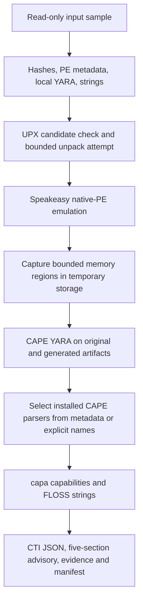

# Automated local analysis container

The container adds an optional automated triage path to StealerForge. It is **not a full Windows sandbox** and does not guarantee containment or maximum detection of modern malware. Use the dedicated lab machine for real hostile samples; use synthetic fixtures to test the pipeline on your everyday workstation. The [remote CAPE lab guide](README-LAB.md) covers real Windows execution and API collection.

See the [readiness assessment](READINESS.md) for verified controls, simulation limits, parser coverage and remaining deployment work. Password-protected archive extraction is not implemented by this CLI; scanning an encrypted ZIP is not equivalent to analyzing its member.

## What happens in one run



| Stage | Actual implementation | Limits |
|---|---|---|
| Preprocessing | UPX on PE files with UPX section-name hints; original retained | Modified packers may evade the hint; output is not assumed correct just because a process exited |
| Windows modeling | Speakeasy in a separate worker process | Native x86/x64 PE or explicitly declared x86/amd64 shellcode; .NET uses the VM workflow |
| Memory acquisition | Read bounded emulated memory regions; retain address/tag/hash and dump bytes | A region may be a loader, heap or simulated library; it is not automatically a reconstructed payload |
| CAPE signatures | Recursively scan `.yar`/`.yara` files, report compile/scan errors | Rules are heuristic; per-file failures remain visible |
| Config extraction | Official installed `cape_parsers.CAPE` modules exposing `extract_config(data)` | Selected by matching `cape_type` metadata or configured parser names; unsupported/no-match results are explicit |
| FLOSS | Full tool JSON retained | String recovery depends on supported language/decoder patterns |
| capa | Rule matches and available ATT&CK metadata retained | Static capability matches do not prove the capability executed |
| Reporting | JSON evidence and deterministic Markdown; optional external LLM use later | No invented attribution or guarantee that encrypted C2 was recovered |

The scan set contains the selected original/imported artifacts plus accepted UPX/emulator outputs. Memory capture prioritizes allocation/heap/view tags and the input image ahead of emulator support mappings; its ordering is a heuristic, and all region omissions remain recorded. Generated dumps are not recursively emulated, avoiding an unbounded expansion. Input/artifact/parser counts and byte/time limits are configurable. No candidate parser is different from a failed parser, and neither means the file is harmless.

### Changes from the proposed design

- Stages integrate with the existing CLI and evidence pipeline.
- Real Speakeasy interfaces and result formats are used. Its timeout is supplied through emulator configuration plus an outer process deadline.
- The container uses pinned Python dependencies and pinned Git commits for rules, rather than mixing `latest` URLs with hard-coded release asset names.
- CAPE parsers are loaded from the official package. It does not assume a `ConfigExtractor` wrapper API or obsolete parser directory inside CAPEv2.
- Memory artifacts remain in a private temporary run directory through analysis and rule validation, then are removed. The container exports selected text reports, not payload files.
- Exceptions and truncation are reported; absence of extracted data is not presented as successful detection.
- **de4dot is not run automatically.** Its own documentation says it can load assemblies for execution. Use it inside the dedicated Windows analysis VM and import the resulting artifact. [de4dot documentation](https://github.com/de4dot/de4dot)
- **Unipacker is not installed or invoked.** Its interactive/packer-specific workflow is not treated as a reliable unattended universal unpacker. UPX and Speakeasy cover the implemented local preprocessing/modeling path; CAPE is the dynamic unpacking path. [Unipacker documentation](https://github.com/unipacker/unipacker)

## Build once

Requirements: Linux/amd64, Docker Engine, Compose, working build-time internet, and enough disk for Python/native dependencies and analysis outputs. The provided UPX artifact is amd64; ARM is not a supported build target here.

From the repository root:

```bash
mkdir -p samples output
docker compose build analyze
```

Build-time downloads install tools and rule/signature data only. `.dockerignore` uses an allowlist so samples, outputs, credentials and local config are not sent into the build context. `container/assets.lock.json` records official repository commits and the UPX release checksum; `requirements-engines.lock` pins the optional Python environment. capa's Python package requires both external rules and library-identification signatures; the build fetches and configures both. [capa installation requirements](https://github.com/mandiant/capa/blob/v9.4.0/doc/installation.md#method-2-using-capa-as-a-python-library)

Tools and the application use separate virtual environments to avoid dependency conflicts. The image contains no Windows guest or CAPE server, and no sample is analyzed during the build.

## Check the container using synthetic tests

```bash
docker compose build test
docker compose run --rm test
docker compose run --rm analyze --preflight
```

The test service has no host sample/output mounts and uses a writable temporary directory for its synthetic fixtures. It checks local interfaces and the complete CLI with the bundled engines, rules and signatures without contacting CAPE, a model API, real C2, or executing real malware.

The suite also checks effective runtime restrictions and Vidar extraction from inert synthetic configuration bytes. These checks do not certify escape resistance or a detection rate. Rebuild the image after dependency changes; an older image will retain its old environment.

## Analyze a file

On your dedicated lab machine, place the chosen input in `samples/`. Then:

```bash
docker compose run --rm analyze -f /samples/sample.exe
```

The entry point selects `--static-only --local-engines --offline-llm`: no remote CAPE submission, no model API call, and no runtime network. `--static-only` here disables CAPE; the explicit local-engines option enables modeled execution.

The image runs as UID/GID `1000:1000`. The host `output/` directory must be writable by that identity. If your lab account has a different UID/GID, use a dedicated output directory and grant that container identity access with your host's ACL/ownership controls. Do not make the whole project world-writable and do not run the analysis service as root to work around output permissions. On SELinux systems, also apply an appropriate label to the dedicated bind mounts.

The original sample mount is read-only. Outputs appear in a unique directory under `output/`:

```text
output/<run>/
├── local_analysis.json         # Per-stage execution status and complete results
├── engine_assets.json          # Pinned rule/tool source provenance
├── local_engines/
│   ├── 0001_inventory/         # Exact package versions and parser inventory
│   ├── ..._upx/               # Output, stdout/stderr and exit status reference
│   ├── ..._speakeasy/
│   │   ├── report.json
│   │   ├── result.json
│   ├── ..._cape_yara/
│   └── ..._cape_parser/
├── stage3_artifact_static.json
├── enrichment/                # capa/FLOSS JSON and stderr
├── enrichment.json
├── artifact_collection.json   # Parent hashes and generated-artifact provenance
├── evidence.json
├── cape_cti_telemetry.json     # Configurations, capabilities, ATT&CK, strings and telemetry
├── threat_intel_report.md     # Five-section advisory; no LLM required
├── report_publication.json    # Text export status and omitted malformed worker reports
├── Evidence_Report.md
├── claude_maximized_prompt.txt
├── run_status.json
└── manifest.json
```

Stage directory numbers vary. Selected worker JSON and valid text logs are exported even
when later stages fail. Malformed worker reports are omitted with a publication record
and review status. Payloads and memory dumps remain in `/tmp` through all analysis
stages and are not exported. A process timeout may prevent a complete report/dump set;
the run is marked accordingly. See [the CTI schema and retention contract](CTI-SCHEMA.md).

Exit code `2` means review is required, including partial local-engine or enrichment
coverage. Inspect the per-stage error rather than rerunning indefinitely. No-match and
not-applicable results remain distinguishable from failures. Raw emulator regions are
explicitly marked unsupported for capa/FLOSS; they still receive YARA/config scans.

## Container restrictions and their limits

Compose supplies:

- No runtime network namespace connectivity (`network_mode: none`).
- A read-only root filesystem and read-only sample mount.
- An unprivileged user, dropped Linux capabilities and no privilege escalation.
- CPU, memory and process-count limits.
- A container swap limit equal to the memory limit, subject to host support.
- `/tmp` on tmpfs with `noexec,nosuid,nodev`; required runtime controls checked before analysis.
- Separate temporary/cache storage and a dedicated writable output mount.
- No Docker socket, privileged mode, host networking or host filesystem root mount.

Workers additionally apply time, address-space and output-file limits on Linux, terminate their process group, and cap generated dump count/bytes. The runtime limits are operational controls, not proof that all native parsers or emulators are vulnerability-free. The writable output directory can contain hostile bytes. Do not mount personal documents, SSH keys, browser profiles or unrelated project directories into this service.

Network isolation retains loopback; it is not a physical air gap. Dropped capabilities
and no-new-privileges do not guarantee prevention of kernel exploits. tmpfs may use
swap, and unmounting does not securely erase physical RAM. Report-only publication
controls normal file handling, not what a compromised process with `/output` access
could write. Use a dedicated analysis VM or lab host for hostile inputs.

No real network is provided to the sample. Speakeasy supplies modeled Windows APIs and simulated responses; this is not INetSim or a complete Windows environment. Missing APIs, .NET, anti-analysis behavior, custom protocols and unsupported paths can stop analysis. [Speakeasy documentation](https://github.com/mandiant/speakeasy)

## Configuration and non-container usage

Edit `container/config.yaml` and rebuild to change the default limits/tool locations. Keep `local_analysis.enabled: true` for the automated local stages. `all_entrypoints: false` models the normal PE entry point; enabling every DLL export can create synthetic behavior that is not an observed launch sequence.

The container defaults to `output.retain_artifacts: false`. Set it to `true` and rebuild
only when persistent payload evidence is needed. To analyze raw code, add
`--shellcode-arch x86` or `--shellcode-arch amd64`; the option applies only to the
primary input. Speakeasy memory snapshots embedded in JSON are disabled. Go/Rust
string recovery uses the installed FLOSS implementation and is not guaranteed for all
compiler versions or obfuscation patterns.

To run the same optional stages in an already isolated Linux analysis VM:

```bash
uv venv .venv-engines --python python3.12
uv pip install --python .venv-engines/bin/python -r requirements-engines.lock
python3 scripts/fetch_assets.py --lock container/assets.lock.json --destination vendor
cp config.yaml config.local.yaml
```

Configure these paths in `config.local.yaml`, using absolute paths or paths relative to that config file:

```yaml
local_analysis:
  enabled: true
  python_path: .venv-engines/bin/python
  upx_path: vendor/upx
  cape_yara_path: vendor/cape_yara
  asset_manifest_path: vendor/manifest.json
  parser_names: []
enrichment:
  capa_path: .venv-engines/bin/capa
  capa_rules_path: vendor/capa_rules
  capa_signatures_path: vendor/capa_signatures
  floss_path: .venv-engines/bin/floss
```

Retain the other config sections. `fetch_assets.py` requires git and internet **during installation only**. Then run:

```bash
.venv/bin/python main.py -c config.local.yaml -f /path/to/sample.exe \
  --static-only --local-engines --offline-llm
```

Running this command directly on a host does **not** establish container network or filesystem isolation. Use the dedicated analysis VM and its network policy. For hybrid analysis, omit `--static-only` and configure CAPE: the normal client collects the real guest report, then optional local engines process the selected artifacts as supplementary evidence.

For a parser you explicitly want to attempt regardless of YARA selection, set `parser_names` to installed module names, for example `['RedLine']`. This is a parser selection hint, not a family verdict. Parser names are restricted to installed CAPE module names; arbitrary module paths are not accepted.

## Optional AI after collection

The container does not need an AI account. Review `Evidence_Report.md` directly or give the exported prompt/evidence to an external analysis tool afterward. Keep the network-disabled service offline instead of adding credentials or unrestricted networking just to run a model.

For Claude Code, ask it to inspect the saved text/JSON, cite evidence IDs, distinguish emulator results from VM observations, and write a report without executing artifacts or contacting extracted addresses. Claude Code's usual model backend is remote even though its CLI runs locally. A local model can consume the same text, subject to its own context capacity.

## Updating and interpreting the build

Update dependency versions and `container/assets.lock.json` deliberately, rebuild, and rerun the synthetic suite. Record the resulting image ID/digest with your investigation. Pinned Python/rule assets do not pin every underlying OS repository package; the base image and apt package supply also affect reproducibility.

The provided tests establish integration behavior on synthetic fixtures. They do not measure detection rates, real-family coverage, robustness against emulator escape, or equivalence to CAPE. Use a curated lab corpus with analyst ground truth for those assessments.
