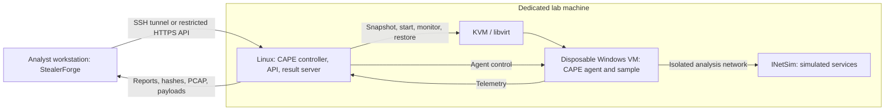

# Remote CAPE lab and artifact collection

This guide separates the analyst workstation, the Linux CAPE controller, and the disposable Windows execution guest. It documents a deployment plan; no firewall, VM, remote service or CAPE installation is changed by running StealerForge's local setup check.

## Recommended arrangement

Use the separate lab machine for real malware execution. Keep the everyday workstation for reports, API access and synthetic pipeline tests. Network simulation is useful, but it is not a containment boundary: a guest can still attack reachable host services or other LAN devices unless the network explicitly prevents it. Docker's kernel isolation also does not provide an absolute escape-prevention guarantee. [Docker security model](https://docs.docker.com/engine/security/)



**CAPE's controller/API runs on Linux. The Windows guest runs the CAPE agent and the sample.** FLARE-VM is an optional Windows analysis-tool environment; it is not the CAPE server or a substitute for its agent. Prefer separate snapshots/VMs for interactive FLARE-VM work and repeatable automated CAPE runs.

| Deployment | Intended use | Recommendation |
|---|---|---|
| Dedicated Linux host + isolated Windows guest | Real Windows malware behavior and artifact capture | Primary analysis path |
| Arch host already managing Windows with KVM | Existing lab with maintained custom configuration | Usable if you maintain CAPE dependencies, routing and libvirt integration |
| Linux analysis container | Automated static parsing, decoding and emulation | Supplementary evidence; use the lab machine for hostile inputs |
| Docker on everyday workstation | Unit tests and synthetic fixtures | Useful development workflow |
| Windows guest bridged to the normal LAN | Malware can reach ordinary LAN devices | Do not use this topology for detonation |

### If the lab host is Arch Linux

The upstream CAPE installer contains Ubuntu/apt-specific operations. Do not run it unchanged on Arch. For a fresh installation, a dedicated host using the distribution supported by the reviewed installer is the easier maintenance path. If you retain Arch, treat CAPE as a manual port: resolve its Python/native dependencies, libvirt permissions, service files and firewall integration yourself. This repository does not provide a tested Arch installation script. [CAPE installer](https://github.com/kevoreilly/CAPEv2/blob/master/installer/cape2.sh)

Putting CAPE in an Ubuntu VM on Arch is another design, but either Windows becomes a nested VM or CAPE needs explicitly configured remote libvirt control. Neither happens automatically. Nested virtualization adds performance and networking complexity; remote libvirt adds another management trust boundary. The examples below assume CAPE and KVM are on the same Linux lab host.

## 1. Plan two distinct networks

The following addresses are examples, not values discovered from your machines:

| Component | Example address | Purpose |
|---|---|---|
| Analyst workstation | `192.168.50.10` | Management client |
| Lab host management interface | `192.168.50.20` | SSH or restricted HTTPS |
| Lab host isolated bridge | `10.77.0.1/24` | Guest result server / analysis gateway |
| Windows guest | `10.77.0.10/24` | Fixed analysis address |
| Separate INetSim guest | `10.77.0.2/24` | Simulated DNS/HTTP/etc. |

Choose a subnet that does not overlap your LAN, VPNs or other VM/container networks. Create an isolated libvirt network/bridge (example name `virbr-cape`) without a physical LAN bridge or default NAT internet uplink. Give the Windows guest **one** analysis NIC, a fixed IP, the intended simulated DNS server, and only the gateway required by the reviewed CAPE routing configuration.

CAPE needs specific communication paths; isolation does not mean blocking its own telemetry. [Guest networking](https://capev2.readthedocs.io/en/latest/installation/guest/network.html), [CAPE result server configuration](https://capev2.readthedocs.io/en/latest/installation/host/configuration.html)

| Source → destination | Allow only what is needed |
|---|---|
| Workstation → lab management interface | SSH, or a restricted HTTPS API endpoint |
| CAPE controller → Windows guest | Agent TCP port, normally `8000` |
| Windows guest → result server | Configured result-server port, commonly TCP `2042` |
| Analysis guest → INetSim | Selected simulated services and DNS |
| Analysis network → normal LAN, internet, host administration | Deny |
| Analysis guest → other analysis guests | Deny or separate per-guest networks when concurrency is used |

Apply filtering to host INPUT and forwarding/bridge paths, not just internet egress. Handle IPv6 as well as IPv4. Restrict SSH, web administration, databases, libvirt, Docker sockets and file shares away from the analysis network. Give an INetSim VM no second unrestricted uplink. Keep stateful replies for required flows working.

Use rules appropriate to your installed nftables/iptables/libvirt/rooter setup. This guide intentionally does not provide a blind firewall replacement: overwriting existing rules can open a route, break CAPE, or lock you out. Inspect the effective rules after CAPE starts and after each routing mode is selected.

Disable shared folders, clipboard sharing, drag-and-drop, host credential forwarding and unnecessary device passthrough on the detonation guest. Use synthetic accounts and data. Snapshot restoration removes guest changes; it cannot undo a compromise outside the guest.

## 2. Install and inventory CAPE on the lab host

Follow the [upstream host installation guide](https://capev2.readthedocs.io/en/latest/installation/host/installation.html) for the checked-out revision. Review the installer before using it on a dedicated host. Its argument syntax can change; use that revision's `--help` rather than copying an old install command.

Record the deployment before changing configuration:

```bash
cd /opt/CAPEv2
git rev-parse HEAD
systemctl cat cape cape-processor cape-web cape-rooter
virsh -c qemu:///system list --all
virsh -c qemu:///system net-list --all
```

These commands assume the usual installation directory/service names. The CAPE service user must be able to manage the intended libvirt connection. Use the Python environment configured in those services for management commands; it may be Poetry, uv, or a dedicated venv.

Upstream supports configuration overrides under `/opt/CAPEv2/custom/conf/`. Merge the fragments below into the corresponding files there; do not replace unrelated database/backend settings or edit only defaults that an update may overwrite. [Configuration override documentation](https://capev2.readthedocs.io/en/latest/installation/host/configuration.html)

## 3. Prepare the Windows guest

1. Create the Windows guest and install the required applications while building the clean image, before introducing any sample.
2. Install a Python version supported by the CAPE revision and deploy that revision's `agent/agent.py` according to its guest instructions.
3. Start the agent with the privileges CAPE requires. Test that it is running from the controller. The agent is a management service; do not expose it on the ordinary LAN.
4. Create synthetic browser profiles, fake documents, and other target data needed for the investigation. Record Windows/browser versions, encryption state and user privileges.
5. Remove build-time sharing/uplinks. Verify the final analysis-only network and result-server connectivity.
6. Save a clean snapshot supported by your KVM/libvirt storage configuration. Use CAPE's documented snapshot procedure and verify restoration before using it with samples.

The agent can be checked from the **lab controller**, not from a public network:

```bash
curl --fail --max-time 5 http://10.77.0.10:8000/
```

An elevated logon task or a snapshot with the agent already running can satisfy guest startup requirements; follow the version-specific instructions. [Agent setup](https://capev2.readthedocs.io/en/latest/installation/guest/agent.html), [snapshot preparation](https://capev2.readthedocs.io/en/latest/installation/guest/saving.html)

Example `custom/conf/kvm.conf` fragment, replacing domain/snapshot/interface names with real ones:

```ini
[kvm]
machines = winlab
interface = virbr-cape
dsn = qemu:///system

[winlab]
label = winlab
platform = windows
ip = 10.77.0.10
arch = x64
tags = win11
snapshot = clean-cape
interface = virbr-cape
```

Use `win10` for a Windows 10 guest. Architecture and tags must match the actual VM and package requirements. [KVM settings](https://github.com/kevoreilly/CAPEv2/blob/master/conf/default/kvm.conf.default)

Example `custom/conf/cuckoo.conf` fragment:

```ini
[cuckoo]
machinery = kvm
max_machines_count = 1

[resultserver]
ip = 10.77.0.1
port = 2042
force_port = yes
```

The result-server IP must exist on the controller and be reachable from the guest. It is **not** the API endpoint. Multiworker or multi-host configurations may use additional addresses/ports. [Result-server defaults](https://github.com/kevoreilly/CAPEv2/blob/master/conf/default/cuckoo.conf.default)

## 4. Configure simulated networking and capture

Install INetSim on the dedicated lab network, either on the controller with restricted bindings or in a dedicated VM. Configure its DNS and fake services for the analysis subnet. In this example it runs at `10.77.0.2`.

Example `custom/conf/routing.conf` fragment:

```ini
[routing]
route = inetsim
internet = none
enable_pcap = yes

[inetsim]
enabled = yes
server = 10.77.0.2
dnsport = 53
interface = virbr-cape
```

Run CAPE's rooter as specified by its installation. Match the routing interface and packet-capture interface to your actual bridge. Check the installed auxiliary sniffer configuration as well. CAPE routing requires its own forwarding/filter rules; an independent deny policy must still prevent routes into your normal LAN. A `none` routing choice is not equivalent to a complete firewall isolation policy. [Routing documentation](https://capev2.readthedocs.io/en/latest/installation/host/routing.html), [routing defaults](https://github.com/kevoreilly/CAPEv2/blob/master/conf/default/routing.conf.default)

Before introducing malware, test with a clean guest:

- The agent and result server communicate and CAPE can restore the clean snapshot.
- Requests to a synthetic hostname reach simulated services and appear in the simulation logs/PCAP.
- The guest cannot establish connections to your workstation, management services, normal LAN or a real internet destination, including through alternate DNS/IPv6 paths.
- Filtering still holds while an analysis is active and after host/service restarts.
- Powering off or disconnecting the analysis network does not affect the management path used to recover the lab.

INetSim provides selected protocol simulations, not a real family-specific C2 conversation. Authentication, certificate checks, custom protocols or missing server responses can prevent later malware stages. Record this as a coverage limitation instead of changing to unrestricted internet merely to make a report look complete.

## 5. Enable reports and artifact-producing modules

Use the full JSON report rather than a lite report that omits API calls. In `custom/conf/reporting.conf`:

```ini
[jsondump]
enabled = yes
store_compressed = no
```

Keep your existing reporting database settings. Confirm behavior, CAPE payload processing, dropped-file and network modules are enabled in the installed processing configuration; inspect their data-volume limits. For example, the behavior processor's call limit can truncate evidence before StealerForge receives it. [Reporting settings](https://github.com/kevoreilly/CAPEv2/blob/master/conf/default/reporting.conf.default), [processing settings](https://github.com/kevoreilly/CAPEv2/blob/master/conf/default/processing.conf.default)

Additional evidence needs explicit collection support:

| Evidence | Requirements / current client behavior |
|---|---|
| Behavioral JSON | Agent/monitor, processing and full JSON reporting; retrieved automatically |
| Payload/process dumps | Monitor capture plus CAPE processing; report-listed binaries retrieved by hash |
| Dropped files | Guest upload and processing; report-listed files retrieved by hash |
| PCAP | Working capture permissions/interface/routing; retrieved automatically when enabled |
| Full guest RAM | Must be enabled separately in CAPE; not retrieved automatically by this client |
| EVTX/Sysmon/ETW | Relevant guest tools/modules and API permission; not automatically ingested by this client |
| Prefetch/Amcache/hives/USN | Separate forensic acquisition/analysis; not guaranteed by a basic CAPE run |

For optional event logging, inspect the `evtx`/`sysmon_windows` and related modules for your installed version and provision their guest dependencies. Enabling a flag alone does not prove data was collected. [Guest auxiliary settings](https://github.com/kevoreilly/CAPEv2/blob/master/conf/default/auxiliary.conf.default)

## 6. Enable a restricted CAPE API

On the Linux CAPE host, merge this fragment into `custom/conf/api.conf`:

```ini
[api]
token_auth_enabled = yes
ratelimit = yes
default_user_ratelimit = 120/m
default_subscription_ratelimit = 120/m

[cuckoostatus]
enabled = yes
auth_only = yes

[filecreate]
enabled = yes
auth_only = yes

[taskview]
enabled = yes
auth_only = yes
rpm = 30/m

[taskreport]
enabled = yes
auth_only = yes

[sampledl]
enabled = yes
auth_only = yes

[taskpcap]
enabled = yes
auth_only = yes
```

The example limits are for one analyst and modest task volume. Endpoint and user-profile throttles can impose lower limits; tune them together. Ten-second polling already makes six requests per minute, exceeding a five-per-minute account default. Artifact downloads add bursts. Keep throttling enabled and size it for actual use. Disable unneeded submission/deletion/download endpoints according to your deployment. [API configuration](https://github.com/kevoreilly/CAPEv2/blob/master/conf/default/api.conf.default)

Enable website authentication if you use the web UI, and keep self-registration disabled for a private lab. For report access restricted to designated accounts, set `general.reports_dl_allowed_to_all = no` in `custom/conf/web.conf` and enable the **Reports** permission on the intended user's profile. Token auth and web-login settings are distinct. [Web configuration](https://github.com/kevoreilly/CAPEv2/blob/master/conf/default/web.conf.default)

### Create the API account and token

Use the installed CAPE Python environment as its service user. For a Poetry installation, start a service-user shell, change to the project, and invoke management commands there:

```bash
sudo -u cape -H bash
cd /opt/CAPEv2
poetry run python web/manage.py createsuperuser
```

Create an admin only if the deployment does not already have one. Through the protected Django admin UI, create a separate active non-superuser account named `stealerforge`, complete its required profile, and grant the report/analysis permissions it needs. Do not reuse the administrator's token for the collector.

Then, in the CAPE environment:

```bash
poetry run python web/manage.py drf_create_token stealerforge
exit
```

Use the runtime from `systemctl cat cape-web` if Poetry is not installed or is not on PATH; for a uv deployment the corresponding prefix is typically `uv run python`. Run `web/manage.py help drf_create_token` if the command is absent before changing installed packages. Store the printed token securely; it grants access to sensitive lab data.

After configuration changes, restart the affected services during a maintenance window with no active task:

```bash
sudo systemctl restart cape-rooter cape cape-processor cape-web
sudo systemctl status cape-rooter cape cape-processor cape-web --no-pager
```

### Reach the API through an SSH tunnel

For a small LAN lab, expose SSH only to your analyst workstation and keep the CAPE web/API listener on lab-host loopback. Verify the actual web service bind configuration; opening a tunnel does not automatically close a listener already bound to every interface. Do not use Django's development server as an internet-facing deployment.

On the workstation, assuming the remote API listens on `127.0.0.1:8000`:

```bash
ssh -N -o ExitOnForwardFailure=yes \
  -L 127.0.0.1:18000:127.0.0.1:8000 labadmin@192.168.50.20
```

Keep that terminal open. StealerForge then uses `http://127.0.0.1:18000/apiv2`. The tunnel encrypts the LAN hop; plain HTTP in this example stays on loopback endpoints. An alternative is restricted HTTPS on the management interface with a trusted certificate, source-IP restrictions and token auth. Do not expose the guest agent, result server, API, or Docker daemon broadly to the LAN/internet.

## 7. Configure StealerForge and collect automatically

On the workstation, in the StealerForge repository:

```bash
cp config.yaml config.local.yaml
```

Edit the corresponding keys in the copy (retain its other sections):

```yaml
cape:
  base_url: "http://127.0.0.1:18000/apiv2"
  api_token_env: "CAPE_API_TOKEN"
  vm_tags: "win11"
  route: "inetsim"
  download_unpacked_payloads: true
  download_dropped_files: true
  download_pcap: true
llm:
  use_api: false
```

Use the actual VM tag or an empty tag string. Read the token without entering it literally into shell history:

```bash
read -rsp 'CAPE API token: ' CAPE_API_TOKEN
export CAPE_API_TOKEN
.venv/bin/python main.py -c config.local.yaml --check-cape
```

Submit and collect in one command:

```bash
.venv/bin/python main.py -c config.local.yaml \
  -f /path/to/sample.exe --offline-llm
```

The pipeline submits to the Linux API, CAPE runs the Windows task, and the client waits for `reported`, downloads JSON and available artifacts, validates binary hashes, performs local analysis, and saves the evidence report. AI is optional. Inspect `artifact_collection.json`, `run_status.json` and coverage warnings; a finished task is not proof of complete behavioral coverage.

The workstation does receive hostile binaries when artifact downloads are enabled, even though it does not launch them. Static parsers also handle untrusted data. For a stronger workstation boundary, run StealerForge itself on a dedicated analysis VM on the lab host and export just the reports you need to the workstation. Do not double-click retrieved artifacts.

### Collect a task already run in CAPE

```bash
.venv/bin/python main.py -c config.local.yaml \
  -f /path/to/the-same-original-sample.exe --task-id 123 --offline-llm
```

This reuses the task and does not detonate it again. The client currently requires the original sample for identity checking/local static analysis. Its SHA256 must match the report if the report supplies one.

An executable launched manually by double-clicking inside FLARE-VM does **not** automatically become a CAPE task. Submit through CAPE for the managed monitor/result-server lifecycle, or import evidence collected by a separate manual workflow. Download from the Linux CAPE API, not from the Windows agent port.

### Reprocess saved evidence without reconnecting to the lab

```bash
.venv/bin/python main.py -f /path/to/sample.exe \
  --cape-report output/RUN/raw_cape_report.json \
  --artifact output/RUN/artifacts/PAYLOAD_HASH.bin \
  --offline-llm
```

Replace `RUN` and the artifact name; repeat `--artifact` as needed. Add `--llm-api` instead of `--offline-llm` only when you want optional API synthesis and have supplied its credentials.

## 8. Manual API diagnostics and downloads

These Bash examples run on the workstation with the tunnel active. Commands use the same venv as StealerForge and retain downloads in a local evidence directory.

```bash
CAPE_API_BASE='http://127.0.0.1:18000/apiv2'
CAPE_TASK_ID=123
mkdir -p collected

# Pass the header over stdin rather than embedding the token in curl's arguments.
cape_get() {
  printf 'Authorization: Token %s\n' "$CAPE_API_TOKEN" |
    curl --fail --silent --show-error --max-time 180 --header @- "$@"
}

cape_get "$CAPE_API_BASE/cuckoo/status/" > collected/status.json
cape_get "$CAPE_API_BASE/tasks/view/$CAPE_TASK_ID/" > collected/task.json
cape_get "$CAPE_API_BASE/tasks/get/report/$CAPE_TASK_ID/json/" > collected/report.json

.venv/bin/python - <<'PY'
import json
from pathlib import Path
from core.evidence import unwrap_report
for name in ('status', 'task'):
    data = json.loads(Path(f'collected/{name}.json').read_text())
    if not isinstance(data, dict) or data.get('error'):
        raise SystemExit(f'{name}: CAPE returned an API error')
report, _ = unwrap_report(json.loads(Path('collected/report.json').read_text()))
print('Task:', report.get('info', {}).get('id'))
print('Target SHA256:', report.get('target', {}).get('file', {}).get('sha256'))
print('Processes:', len(report.get('behavior', {}).get('processes', [])))
PY
```

CAPE can return HTTP 200 with an error JSON object, so `curl --fail` alone is insufficient. Never label downloaded bytes as a payload solely because the response was HTTP 200.

For a SHA256 listed under `CAPE.payloads`, `procdump`, or `dropped` in the report:

```bash
read -rp 'Report-listed artifact SHA256: ' CAPE_ARTIFACT_SHA256
if [[ "$CAPE_ARTIFACT_SHA256" =~ ^[a-fA-F0-9]{64}$ ]]; then
  cape_get "$CAPE_API_BASE/files/get/sha256/$CAPE_ARTIFACT_SHA256/" \
    > "collected/$CAPE_ARTIFACT_SHA256.bin"
  printf '%s  %s\n' "$CAPE_ARTIFACT_SHA256" "collected/$CAPE_ARTIFACT_SHA256.bin" | sha256sum --check -
fi

cape_get "$CAPE_API_BASE/tasks/get/pcap/$CAPE_TASK_ID/" > collected/dump.pcap
```

Verify the PCAP format in your isolated analysis environment; that endpoint can also return an API error. Prefer the built-in collector for bounded streaming, cleanup and format/hash checks. Manual shell examples do not enforce StealerForge's byte limits.

| Data | Current upstream endpoint | Automatic here? |
|---|---|---|
| Full JSON | `/tasks/get/report/{id}/json/` | Yes |
| Binary by hash | `/files/get/sha256/{hash}/` | Yes, for listed artifacts |
| PCAP | `/tasks/get/pcap/{id}/` | Yes when enabled |
| Original sample by task | `/files/get/task/{id}/` | Manual if you need the original before `--task-id` |
| Process memory bundle | `/tasks/get/procmemory/{id}/` | Manual |
| Full guest RAM | `/tasks/get/fullmemory/{id}/` | Manual; only if collected |
| Dropped-file bundle | `/tasks/get/dropped/{id}/` | Manual bundle; individual listed files are automatic |
| EVTX | `/tasks/get/evtx/{id}/` | Manual; version/module dependent |

Confirm these against your deployed `/apiv2/` documentation; optional endpoints need separate permissions and may return archives. Extract archives only in an isolated working directory with traversal/size controls. [Upstream API routes](https://github.com/kevoreilly/CAPEv2/blob/master/web/apiv2/urls.py)

CAPE's usual server-side analysis store is `/opt/CAPEv2/storage/analyses/<task-id>/`. Retain the source reports/logs/PCAP and captured artifacts there according to your lab policy; do not expose that directory as a guest-accessible file share. [Analysis results layout](https://capev2.readthedocs.io/en/latest/usage/results.html)

## 9. Troubleshooting

| Symptom | Check |
|---|---|
| `--check-cape` returns an API error | Enable `cuckoostatus`, token authentication and the account; verify the tunnel/API base URL |
| HTTP 401/403 | `Authorization: Token ...`, active user/profile, per-endpoint and report permissions |
| HTTP 429 | Account/subscription/endpoint throttles versus polling and download rates |
| Task remains pending | Machine tags, architecture, package requirements, free disk, worker/service health |
| Guest starts but no API calls | Agent privileges, monitor compatibility, result-server route/firewall, full JSON versus lite report |
| Reported task has zero dumps/configs | No capture occurred, unsupported family, early exit, monitor limitations, or processing disabled; not a universal proof of clean behavior |
| Hash download fails | `sampledl` permission, retained artifact availability, storage/indexing, expired data, or API error content |
| PCAP absent | Capture interface, permissions, auxiliary sniffer and routing settings |
| Internet simulation appears to work but sample stops | C2 protocol/TLS/environment dependencies may be unmet |
| Report target hash differs | Wrong task, wrong original sample or server-side demultiplexing; do not force mismatched evidence together |

Useful read-only diagnostics on the lab host:

```bash
sudo journalctl -u cape -u cape-processor -u cape-web -u cape-rooter -n 100 --no-pager
sudo ss -lntup
virsh -c qemu:///system domiflist winlab
virsh -c qemu:///system snapshot-list winlab
```

For your actual installation, record the CAPE revision, monitor revision, guest snapshot, browser versions, network policy, tool versions and collection limits with each investigation. Full automation can automate repeatable collection; it cannot guarantee that a particular modern infostealer reveals every behavior in one run.
